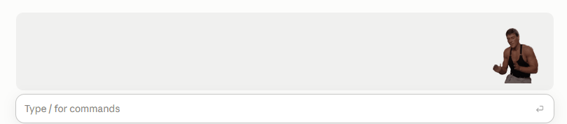

# claude-mods

My Claude Code mods, shared as a plugin marketplace called `my-mods`.

## jeanCLAUDE

A dancing GIF in the band above the prompt. It dances while Claude is working and freezes when Claude stops.
Works in the Claude desktop app only (the terminal version has no band above the prompt).



Tip: the animation looks best with a light theme. On a dark theme the edges of the GIF can stand out.

### Install

In Claude Code (desktop app), run:

```
/plugin marketplace add gblachstein/claude-mods
/plugin install jeanCLAUDE@my-mods
```

Then start a new session (or run `/reload-plugins`). Switch it off any time from the plugin list.

### Update

```
/plugin marketplace update my-mods
```

## Just for fun

This is a silly little side project made for fun. It is not affiliated with, endorsed by, or connected to
Jean-Claude Van Damme or anyone involved with the clip the GIF comes from. The name is just a pun.

The GIF belongs to its rights holders. I'm not making any money from it and claim no ownership of it.
If you own the clip, or appear in it, and want it taken down, open an issue on this repo and it will be removed.
